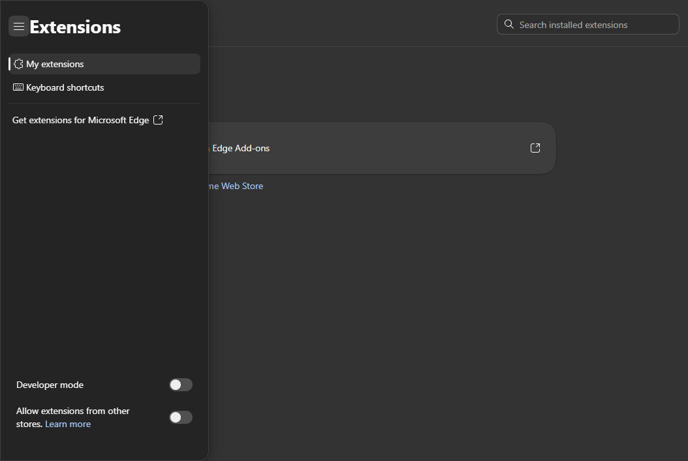
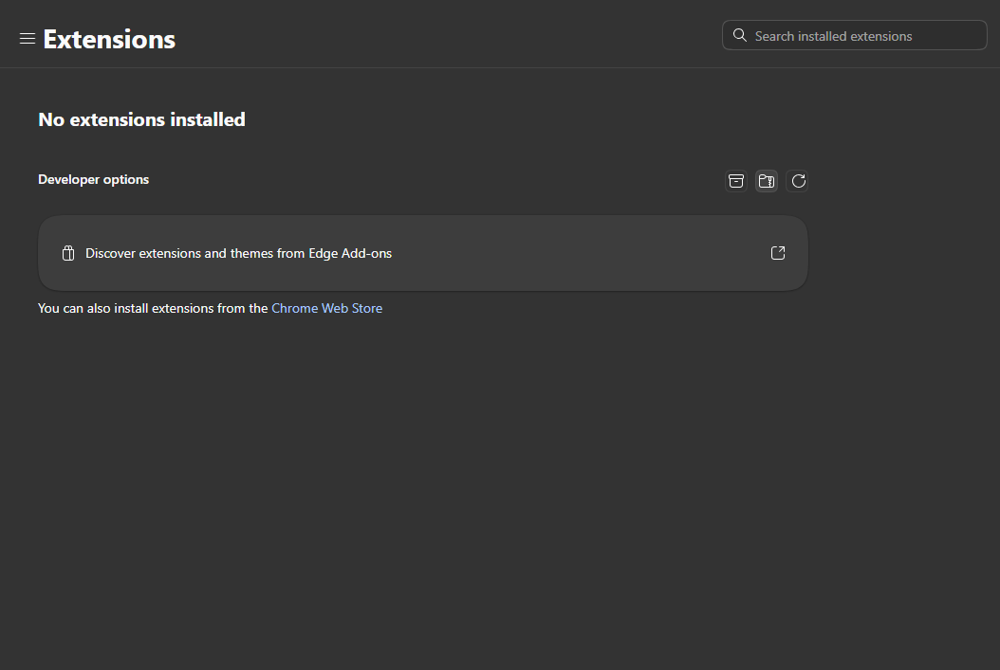
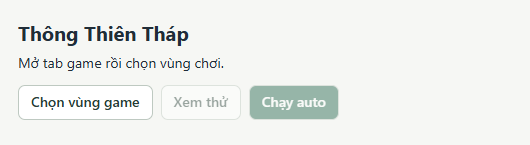
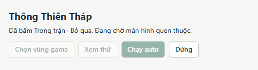

# Auto Thông Thiên Tháp H5

Extension cho Chrome và Edge, tự nhận diện màn hình để khiêu chiến, bấm **Bỏ qua** khi vào trận, sang ải sau khi thắng và đánh lại sau khi bại. Nếu game trở về **Lịch Luyện** giữa trận, extension đi qua **Thông Thiên Tháp → Tứ Linh Tháp → ô đang sáng** để quay lại trận.

## Cài đặt

1. Tải repo về máy hoặc tải ZIP từ GitHub rồi giải nén.
2. Mở `chrome://extensions` hoặc `edge://extensions`. Bật **Chế độ dành cho nhà phát triển**. Trên Edge, nút này nằm trong menu ☰.

   

3. Chọn **Load unpacked** (Tải tiện ích đã giải nén) rồi chọn **thư mục chứa `manifest.json`** của repo này. Trên Edge, nút này là biểu tượng thư mục ở mục **Developer options**.

   

## Sử dụng

1. Mở game và vào **Thông Thiên Tháp**. Bấm biểu tượng extension trên chính tab game, rồi chọn **Chọn vùng game**.

   

2. Kéo trên ảnh xem trước để chọn sát **toàn bộ khung game dọc**. Sau đó bấm **Xem thử** để kiểm tra nhận diện hoặc **Chạy auto** để bắt đầu.

   

3. Mở lại extension và bấm **Dừng** khi muốn kết thúc. Khi chuyển sang tab khác trong cùng cửa sổ, auto tạm chờ đến lúc bạn quay lại tab game.

   

Nếu thay đổi kích thước cửa sổ hoặc mức thu phóng, hãy bấm **Dừng** rồi chọn lại vùng game. Chrome và Edge hiển thị thông báo gỡ lỗi trong lúc extension chụp màn hình và gửi thao tác bấm vào tab game.

Ảnh minh họa được chụp trong hồ sơ Edge thử riêng với màn hình game mô phỏng và thông tin tài khoản đã được che.

**Lưu ý**: Extension hoạt động theo cơ chế chụp màn hình tab game, nhận diện nút trong ảnh và gửi thao tác chuột qua quyền debugger. Nó chỉ đọc kích thước vùng hiển thị khi cần tính tọa độ, không sửa tệp hay mã JavaScript của game, cũng không gọi API của game nên không cần lo lắng về việc bị khóa tài khoản. Quyền debugger là quyền rộng, nên Chrome hiện thông báo gỡ lỗi khi extension chạy.